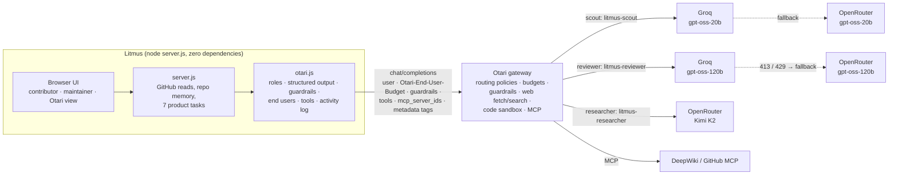

<div align="center">

# 🧪 Litmus

### The test happens before the code.

**Litmus matches open-source contributors to issues they can land, pressure-tests their plan against the real codebase before they write code, and gives maintainers a trust-ranked review queue. It runs on three open-weight models through [Otari](https://github.com/mozilla-ai/otari), with routing fallbacks, guardrails on untrusted text and per-contributor budgets.**

Built for Mozilla.ai's *Developers Wilding* hackathon · [Demo repository](https://github.com/Vidhaankhare16/Google-Gen-AI/issues) · [Otari setup](docs/OTARI-SETUP.md)

</div>

---

## The problem

Open source is under pressure from two directions at once.

Popular repositories are flooded with low-quality contributions, many of them AI-generated, from submitters who cannot explain them when asked. Curl ended its six-year bug bounty over exactly this. The Jazzband Python collective shut down. Forty-five percent of maintainers name burnout as their single biggest challenge.

Small repositories have the opposite problem. Good contributors cannot find them, and contributing feels intimidating. Onboarding is consistently the top maintainer pain point.

Existing bots screen finished code, and by then the wasted work has already happened. Litmus works earlier: it matches the right person to the right issue and gets the approach right before any code exists. It never tries to detect AI authorship. It asks whether the work can explain itself against this codebase.

## What Litmus does

- **Contributor matching.** Litmus reads your public repositories (languages by bytes, topics, recency) and ranks live, unassigned issues in under-served repos, citing the evidence for each match.
- **Repo memory.** On first connection Litmus builds a durable map of the repository: modules, import edges, tests, conventions and constraint signals such as locks, shutdown paths and public API. The map is keyed to the branch SHA.
- **Sixty-second orientation.** A tour of the files an issue touches and the non-obvious constraints a newcomer would trip over.
- **Plan check with revisions.** Your stated approach is checked against the real callers, and every point must cite `path:line`. A revision is judged against the previous feedback. In the demo repo the reviewer finds that calling `delete_document()` inside `store_document()` re-acquires a non-reentrant `threading.Lock` and deadlocks.
- **Bot screening question and answer assessment.** Litmus writes one question that only someone who opened the file can answer, then judges the reply. Posting to GitHub is off by default (preview mode).
- **PR trust brief.** The diff, the planning trail, a drift check and structural risk, reduced to one verdict: `strong_signal`, `needs_review` or `weak_signal`.
- **Maintainer priority queue.** You state your focus in plain language and Litmus ranks issues and PRs around it, flagging cross-PR collisions.
- **Contribution trail.** Every plan, revision and screening answer, plus any prompt-injection attempt Otari caught, travels with the contributor.

## Architecture



| Role | Default model (open-weight) | Jobs | Why this model |
|---|---|---|---|
| `scout` | `groq:openai/gpt-oss-20b` | contributor matching, screening question, priority queue | Answers in about 1–3 s for $0.0002–0.0005. Context is trimmed to fit Groq's free tier. |
| `reviewer` | `openrouter:openai/gpt-oss-120b` (`groq:` via policy) | orientation, plan check, answer assessment, trust brief | Reasons at high effort over about 22k tokens of repository context. |
| `researcher` | `moonshotai/kimi-k2-instruct-0905` | tool-using grounding: DeepWiki / GitHub MCP, web fetch of linked docs | Strong at tool calls. Runs as free text, so the tool loop never fights strict JSON. |

## Where Litmus uses each Otari feature

| Otari feature | Where Litmus uses it | Code | How to see it in the demo |
|---|---|---|---|
| Open-weight models (≥2, distinct purposes) | gpt-oss-20b scouts, gpt-oss-120b reviews, Kimi K2 researches | `otari.js` `ROLES`, `roleConfig` | Otari view → Roles. Every result card has a provenance line with the served `provider:model`. |
| Model routing & fallbacks | Each role may name a policy (`litmus-scout`, `litmus-reviewer`, `litmus-researcher`). Litmus records `Otari-Fallback`, `Otari-Attempt-Count`, `Otari-Provider`, `Otari-Model`, `Server-Timing`. An unknown policy gets a visible in-app fallback. | `otari.js` `send`, `readHeaders` | `npm run demo -- fallback`. The provenance line says `fallback: yes · 2 attempts`. |
| Multiple models in distinct roles | scout / reviewer / researcher | `server.js` task call sites | Activity table, role column |
| Guardrails | `prompt-injection` in `block` mode on plan text, bot replies and PR descriptions, always the latest user message. A block becomes a trail event. | `otari.js` `chatJson`, `guardrailEntries`; `server.js` `recordGuardrailEvent` | `npm run demo -- injection`. The reply card says "Otari guardrail blocked the reply", and the trust brief and queue flag the contributor. |
| Per-user budgets | `user` = `github:<login>` or `maintainer:<owner>`, plus `Otari-End-User-Budget` for contributor vs maintainer budgets. Refusals become an allowance message. | `otari.js` `endUserFields`, `classify` | `npm run demo -- budget`: one contributor is stopped and another continues. |
| Budgets & spending limits | `usage.cost_usd` on every call, `GET /key/budget` remaining, `budget_exceeded` handled, spend grouped by `end_user` tag | `server.js` `otariStatus` | Otari view → Key budget, Spend by person |
| Web fetch / search | Researcher fetches docs linked from the issue or plan (`otari_web_fetch`, optional `otari_web_search` with `max_uses`) | `otari.js` `research` | Plan review → "Docs read by Otari web fetch", with `otari_tool_calls` |
| MCP | `mcp_server_ids` (workspace DeepWiki / GitHub) or inline DeepWiki with `purpose_hint` and `allowed_tools` | `otari.js` `mcpConfig`, `research` | Orientation → "Grounding from Otari tools" |
| Code execution | A fenced snippet in a plan runs in `otari_code_execution` and its stdout feeds the reviewer | `otari.js` `runSnippet` | Plan with a code block → "Your snippet, run in Otari's code sandbox" |

The Otari view (`/#otari`) counts a feature as **in use** only when Litmus's own calls used it. Its source is `GET /api/otari/status`, which reads the activity log plus live probes of `/models`, `/tools`, guardrail profiles, MCP servers and `/key/budget`. Each feature shows its last request id.

## Run it

Requires Node 22. There is nothing to install.

```bash
cp .env.example .env      # add OTARI_API_KEY, OTARI_BASE_URL, GITHUB_TOKEN
npm run smoke             # one tiny call per role: provider, model, fallback, cost, request id
npm start                 # http://localhost:4173  (Otari view: /#otari)
npm test                  # offline self-test of otari.js against a mock gateway
npm run demo -- all       # plan check, injection attempt, fallback, per-user budget
```

The dashboard steps that switch on routing policies, the service key and end-user budgets, the guardrail, the Tools toggles and the MCP servers are in **[docs/OTARI-SETUP.md](docs/OTARI-SETUP.md)**. Each step names the env var to set afterwards. All variables are documented in [`.env.example`](.env.example).

| Route | Purpose |
|---|---|
| `POST /api/contributor-match` | Evidence-based issue matching (scout) |
| `POST /api/orient-issue` | Orientation, grounded by the researcher when tools are on (reviewer) |
| `POST /api/analyze-plan` | Plan check with research and sandbox grounding; records the trail (reviewer) |
| `POST /api/analyze-pr` | Trust brief with drift check (reviewer) |
| `POST /api/maintainer-priority` | Intent-driven queue (scout) |
| `POST /api/bot/ask`, `POST /api/bot/assess` | Screening question (scout) and answer assessment (reviewer); `previewReply` in preview mode |
| `GET /api/otari/status`, `GET /api/otari/activity` | Rubric features with evidence; last 200 calls |
| `GET /api/health`, `/api/trail`, `/api/repo-graph`, `/api/register-repo` | The rest of the app |

## What is verified, and what needs the dashboard

Verified live on otari.ai (EU) on 2026-11-09:

- All seven tasks run through Otari on open-weight models with strict `json_schema` on Chat Completions: Groq gpt-oss-20b, OpenRouter gpt-oss-120b, and Kimi K2 via OpenRouter.
- Otari's routing headers, `usage.cost_usd`, the `Otari-Guardrails` verdict and the request id are captured on every call.
- A routing-policy name Otari does not know gets `400 invalid_model`. Litmus falls back visibly.
- A non-service key refuses `user` with 403. Litmus falls back to request tags, so spend per person still shows.
- Refusals degrade cleanly and are recorded: web tools disabled (403), inline MCP disallowed (400), code execution unfunded (402).
- `npm test` exercises a guardrail block, an end-user budget refusal, a non-strict model and a repair turn against a mock gateway.

Needs dashboard configuration first (the Otari view says which): routing policies, the service key and end-user budgets, a key ceiling, a guardrail definition (the hosted deployment has no guardrails service), the Tools toggles, and workspace MCP servers. The paid tools also need balance or an organization search key.

## Migration story: GPT-5.6 → open-weight models via Otari

Litmus started on OpenAI's Responses API with GPT-5.6 and strict JSON schemas. The [first Otari commit](https://github.com/Vidhaankhare16/litmus/commit/44d19be) is a small swap: base URL, key and model, from `/responses` + `text.format` to `/chat/completions` + `response_format`. The schemas stayed the same.

What changed, and what broke:

- **Strict JSON held up.** gpt-oss-20b/120b on Groq and OpenRouter and Kimi K2 all accepted Litmus's strict schemas (nested objects, enums, integer bounds, `maxItems`). Litmus still validates locally, retries with `json_object` plus the schema in the prompt if a model refuses strict mode, and allows one repair turn.
- **Reasoning budgets.** gpt-oss and Qwen 3.5 are reasoning models. With small `max_tokens` they return `content: null` and `finish_reason: length`, because reasoning used the budget. Litmus sets per-role token budgets and retries at low effort when that happens.
- **Context limits are a provider property.** Groq's free tier refused a 22k-token plan check with HTTP 413 (Otari surfaced it as 502). The fix is a per-role context budget plus a fallback policy, so Groq serves what fits and OpenRouter serves the rest.
- **Quality needed prompting.** At medium effort, gpt-oss-120b called the deadlock plan "sound", where GPT-5.6 had caught it. High effort, an explicit "trace what the plan executes call by call" method, and putting the plan last in the prompt brought the finding back, with three cited line ranges.
- **Prompt order now matters for safety.** Otari's input guardrails screen only the latest user message, so untrusted text always goes last and repository context goes before it.

## How it is built

A zero-dependency Node server and a vanilla JavaScript front end, with no framework, build step or `node_modules`. Repo memory walks the git tree through the GitHub API, selects up to 56 structurally interesting files, resolves imports into a dependency graph and scores structural risk. `otari.js` is the single gateway client. It keeps a 200-call activity log in `data/otari-activity.json`, so a restart keeps the demo history.

<div align="center">

**Litmus never claims to detect AI. It asks one question, and listens to the answer.**

</div>
