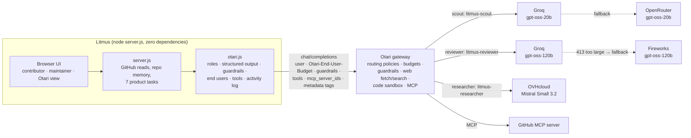

<div align="center">

# 🧪 Litmus

### The test happens before the code.

**Litmus matches open-source contributors to issues they can land, pressure-tests their plan against the real codebase before they write code, and gives maintainers a trust-ranked review queue. It runs on three open-weight models through [Otari](https://github.com/mozilla-ai/otari), with routing fallbacks, guardrails on untrusted text and per-contributor budgets.**

Built for Mozilla.ai's *Developers Wilding* hackathon · **[Try it live](https://litmus-822987556610.us-central1.run.app)** · [Demo repository](https://github.com/Vidhaankhare16/Google-Gen-AI/issues) · [Otari setup](docs/OTARI-SETUP.md) · [Contributions back to Otari](#contributing-back-to-otari)

</div>

---

## The problem

Open source is under pressure from two directions at once.

Popular repositories are flooded with low-quality contributions, many of them AI-generated, from submitters who cannot explain them when asked. Curl ended its six-year bug bounty over exactly this. The Jazzband Python collective shut down. Forty-five percent of maintainers name burnout as their single biggest challenge.

Small repositories have the opposite problem. Good contributors cannot find them, and contributing feels intimidating. Onboarding is consistently the top maintainer pain point.

Existing bots screen finished code, and by then the wasted work has already happened. Litmus works earlier: it matches the right person to the right issue and gets the approach right before any code exists. It never tries to detect AI authorship. It asks whether the work can explain itself against this codebase.

## What Litmus does

- **Contributor matching.** Litmus reads your public repositories (languages by bytes, topics, recency) and ranks live, unassigned issues in under-served repos, citing the evidence for each match.
- **Repo memory.** On first connection Litmus builds a durable map of the repository: modules, import edges, tests, conventions and constraint signals such as locks, shutdown paths and public API. The map is keyed to the branch SHA.
- **Sixty-second orientation.** A tour of the files an issue touches and the non-obvious constraints a newcomer would trip over.
- **Plan check with revisions.** Your stated approach is checked against the real callers, and every point must cite `path:line`. A revision is judged against the previous feedback. In the demo repo the reviewer finds that calling `delete_document()` inside `store_document()` re-acquires a non-reentrant `threading.Lock` and deadlocks.
- **Bot screening question and answer assessment.** Litmus writes one question that only someone who opened the file can answer, then judges the reply. Posting to GitHub is off by default (preview mode).
- **PR trust brief.** The diff, the planning trail, a drift check and structural risk, reduced to one verdict: `strong_signal`, `needs_review` or `weak_signal`.
- **Maintainer priority queue.** You state your focus in plain language and Litmus ranks issues and PRs around it, flagging cross-PR collisions.
- **Contribution trail.** Every plan, revision and screening answer, plus any prompt-injection attempt Otari caught, travels with the contributor.

## Architecture



| Role | Open-weight model (licence) | Jobs | Why this model |
|---|---|---|---|
| `scout` | gpt-oss-20b (Apache-2.0), Groq first | contributor matching, screening question, priority queue, screening of research findings | Answers in 1–3 s for a fraction of a cent. Context is trimmed to fit Groq's free tier. |
| `reviewer` | gpt-oss-120b (Apache-2.0), Groq first, then Fireworks, then OVHcloud | orientation, plan check, answer assessment, trust brief | Reasons at high effort over about 25k tokens of repository context. Groq refuses requests that size, so the policy moves them to Fireworks, the fastest host Litmus measured (about 100 tokens/s against 20–40 elsewhere). |
| `researcher` | Mistral Small 3.2 24B (Apache-2.0) on OVHcloud, then gpt-oss-120b on Fireworks | reads the repository through the GitHub MCP server and fetches docs a plan or issue links to | A different model family from the other two, chosen for tool calls: it made the right MCP and web-fetch calls in 9 s where Kimi K2 took 90 s through a fallback. Runs as free text, so the tool loop never fights strict JSON. |

Each role names an Otari routing policy, so the provider order lives in the Otari dashboard, not in the code. A call that gets no answer within the role's time limit (45 s, or 110 s for the reviewer) is retried once on a different provider, because Otari's fallback acts only before an answer starts.

## Where Litmus uses each Otari feature

| Otari feature | Where Litmus uses it | Code | How to see it |
|---|---|---|---|
| Open-weight models, two or more for different purposes | gpt-oss-20b scouts, gpt-oss-120b reviews, Mistral Small 3.2 researches | `otari.js` `ROLES` | Otari view → Roles. Every result has a provenance line with the model that served it. |
| Model routing & fallbacks | Every role calls a policy (`litmus-scout`, `litmus-reviewer`, `litmus-researcher`). Litmus records `Otari-Fallback`, `Otari-Attempt-Count`, `Otari-Provider`, `Otari-Model`. An unknown policy gets a visible in-app fallback, and a stalled provider a retry elsewhere. | `otari.js` `send` | Plan review provenance: `fallback: yes · 2 attempts` (Groq refused the 25k-token request; Fireworks served it). |
| Multiple models in distinct roles | scout / reviewer / researcher | `server.js` task call sites | Activity table, role column |
| Guardrails | A `prompt-injection` guardrail in `block` mode on every piece of text a stranger wrote: plans, bot replies, PR descriptions, and what the researcher brought back from web pages and repository files. That last one gets its own screening call, because Otari screens only the latest user message and in the review that slot belongs to the plan. Flagged findings are set aside, and the review runs without them. A block becomes an event on the contributor's trail. | `otari.js` `chatJson`, `screenResearch`; `server.js` `recordGuardrailEvent` | Bot reply with an injection → "Otari guardrail blocked the reply"; research box → "screened by guardrail: clean". |
| Per-user budgets | A service key. Each person is their own Otari end user (`github:<login>`, `maintainer:<owner>`) on a contributor ($0.50/day), trial ($0.05/day) or maintainer ($1/day) budget, chosen with `Otari-End-User-Budget` and changed with `PUT /end-users`. A refusal becomes an allowance message. | `otari.js` `endUserFields`, `setEndUserBudget` | Maintainer → Allowances: put a newcomer on the trial allowance, see spend per person. |
| Budgets & spending limits | A $10 monthly ceiling on the key. **Budget saver:** before each call Litmus reads `GET /key/budget`; with 20% or less left it stops paying for web fetch and code execution and lowers the reviewer's reasoning effort, so plan checks keep working until the period resets. `usage.cost_usd` is recorded on every call. | `otari.js` `budgetSaver` | Allowances → "Whole app: $… used of the $10 limit"; Otari view → Budgets |
| Web fetch | The researcher fetches docs linked from the issue or plan with `otari_web_fetch` | `otari.js` `research` | Plan review → "What the researcher read through Otari" |
| MCP | The workspace's GitHub MCP server, by `mcp_server_ids`: the researcher reads the live file the issue touches with `get_file_contents` | `otari.js` `research` | Orientation and plan review → `mcp:get_file_contents · completed` |
| Code execution | A fenced snippet in a plan runs in `otari_code_execution`, and its stdout feeds the reviewer | `otari.js` `runSnippet` | Plan with a code block → "Your snippet, run in Otari's code sandbox" |

The Otari view (`/#otari`) marks a feature **in use** only when Litmus's own calls used it, with the last request id as proof.

## Run it

Requires Node 22. There is nothing to install.

```bash
cp .env.example .env      # add OTARI_API_KEY, OTARI_BASE_URL, GITHUB_TOKEN
npm run verify            # checks every Otari dashboard step live; --write fills .env with the ids it finds
npm run smoke             # one tiny call per role: provider, model, fallback, cost, request id
npm start                 # http://localhost:4173  (Otari view: /#otari)
npm test                  # offline self-test of otari.js against a mock gateway
npm run demo -- all       # plan check, injection attempt, fallback, per-user budget
npm run eval              # 3 plans with known answers, run twice each, against the running server
```

The dashboard steps that switch on routing policies, the service key and end-user budgets, the guardrail, the Tools toggles and the MCP servers are in **[docs/OTARI-SETUP.md](docs/OTARI-SETUP.md)**. Each step names the env var to set afterwards. All variables are documented in [`.env.example`](.env.example).

| Route | Purpose |
|---|---|
| `POST /api/contributor-match` | Evidence-based issue matching (scout) |
| `POST /api/orient-issue` | Orientation, grounded by the researcher when tools are on (reviewer) |
| `POST /api/analyze-plan` | Plan check with research and sandbox grounding; records the trail (reviewer) |
| `POST /api/analyze-pr` | Trust brief with drift check (reviewer) |
| `POST /api/maintainer-priority` | Intent-driven queue (scout) |
| `POST /api/bot/ask`, `POST /api/bot/assess` | Screening question (scout) and answer assessment (reviewer); `previewReply` in preview mode |
| `GET /api/otari/status`, `GET /api/otari/activity` | Rubric features with evidence; last 200 calls |
| `GET /api/health`, `/api/trail`, `/api/repo-graph`, `/api/register-repo` | The rest of the app |

## How well it works

`npm run eval` sends three plans with a known right answer for issue #1 of the demo repository, as fresh contributors, through the live Otari setup above. Results on 2026-11-11, two runs each:

| Plan | What a correct review says | Result |
|---|---|---|
| Call `delete_document()` from inside `store_document()` | major gaps: it deadlocks, because both take the same non-reentrant `threading.Lock` | 2 of 2 |
| Evict inside the lock already held, clean up after releasing it | not major gaps, and no deadlock claimed | 2 of 2 |
| Rename `get_stats()`, which an API route calls | gaps: it breaks the `/stats` route | 2 of 2 |

All 33 `path:line` citations in those reviews were confirmed against the code. Litmus checks every citation itself, without a model: the file must be in the repository map, the lines must exist, and the cited symbol must be at those lines or be the function that contains them. Each one is marked **verified**, **lines approximate** or **not confirmed** in the review. Median time per plan check was about a minute, including the researcher's tool calls, and the average cost was 1.4 cents.

## What is verified live

On otari.ai (EU), 2026-11-11:

- All seven tasks run through Otari routing policies on open-weight models with strict `json_schema`.
- The reviewer's 25k-token requests fall back from Groq (HTTP 413) to Fireworks, and `Otari-Fallback` / `Otari-Attempt-Count` say so.
- The researcher's tool calls run through Otari: `get_file_contents` on the GitHub MCP server and `otari_web_fetch` on linked docs.
- The demo injection is blocked with `403 guardrail_violation` before any model reads it, and an ordinary plan is not.
- End users are billed separately on the service key, and the trial allowance is set through `PUT /end-users`.
- `npm test` covers the same paths offline against a mock gateway: guardrail block, end-user refusal, a non-strict model, a repair turn, a stalled provider, research screening and the budget saver.

## Migration story: GPT-5.6 → open-weight models via Otari

Litmus started on OpenAI's Responses API with GPT-5.6 and strict JSON schemas. The [first Otari commit](https://github.com/Vidhaankhare16/litmus/commit/44d19be) is a small swap: base URL, key and model, from `/responses` + `text.format` to `/chat/completions` + `response_format`. The schemas stayed the same.

What changed, and what broke:

- **Strict JSON held up.** gpt-oss-20b/120b on Groq, Fireworks, OVHcloud and OpenRouter, and Mistral Small 3.2, all accepted Litmus's strict schemas (nested objects, enums, integer bounds, `maxItems`). Litmus still validates locally, retries with `json_object` plus the schema in the prompt if a model refuses strict mode, and allows one repair turn.
- **Reasoning budgets.** gpt-oss and Qwen 3.5 are reasoning models. With small `max_tokens` they return `content: null` and `finish_reason: length`, because reasoning used the budget. Litmus sets per-role token budgets and retries at low effort when that happens.
- **Context limits are a provider property.** Groq's free tier refused a 22k-token plan check with HTTP 413 (Otari surfaced it as 502). The fix is a per-role context budget plus a fallback policy, so Groq serves what fits and OpenRouter serves the rest.
- **Quality needed prompting.** At medium effort, gpt-oss-120b called the deadlock plan "sound", where GPT-5.6 had caught it. High effort, an explicit "trace what the plan executes call by call" method, and putting the plan last in the prompt brought the finding back, with three cited line ranges.
- **Prompt order now matters for safety.** Otari's input guardrails screen only the latest user message, so untrusted text always goes last and repository context goes before it.

## Contributing back to Otari

Building Litmus turned up bugs in Otari itself. Each one was filed with request ids and a reproduction, and some with a fix:

- **PR [#3026](https://github.com/mozilla-ai/otari/pull/3026), merged:** `/v1/responses` returned `text.format.schema` as `schema_`, so structured output was not a valid Responses object. Fixes [#3025](https://github.com/mozilla-ai/otari/issues/3025).
- **PR [#3065](https://github.com/mozilla-ai/otari/pull/3065):** a routing policy still sent `reasoning` / `thinking` to a non-reasoning fallback on Responses and Messages ([#3034](https://github.com/mozilla-ai/otari/issues/3034)).
- **PRs [#3066](https://github.com/mozilla-ai/otari/pull/3066) and [#3067](https://github.com/mozilla-ai/otari/pull/3067):** docs for the routes a key reads its budget from ([#3030](https://github.com/mozilla-ai/otari/issues/3030)), and for fetch and code execution billing end users ([#3027](https://github.com/mozilla-ai/otari/issues/3027)).
- **Issues fixed by the maintainers:** a provider's 413 came back as a retryable 502 ([#3028](https://github.com/mozilla-ai/otari/issues/3028)); OpenRouter-key completions were priced 0.4–4.9× off ([#3029](https://github.com/mozilla-ai/otari/issues/3029)); a BYO-key code-execution 402 that `/tools` hid ([#3031](https://github.com/mozilla-ai/otari/issues/3031)); Groq's `json_validate_failed` came back as a bare 400 ([#3033](https://github.com/mozilla-ai/otari/issues/3033)).
- **Open:** stable error codes for two refusals ([#3032](https://github.com/mozilla-ai/otari/issues/3032)), and Groq streaming with `response_format` in any-llm ([any-llm #1627](https://github.com/mozilla-ai/any-llm/issues/1627)).

Security findings went privately to Mozilla.ai and are not described here.

## How it is built

A zero-dependency Node server and a vanilla JavaScript front end, with no framework, build step or `node_modules`. Repo memory walks the git tree through the GitHub API, selects up to 56 structurally interesting files, resolves imports into a dependency graph and scores structural risk. `otari.js` is the single gateway client. It keeps a 200-call activity log in `data/otari-activity.json`, so a restart keeps the demo history.

<div align="center">

**Litmus never claims to detect AI. It asks one question, and listens to the answer.**

</div>
